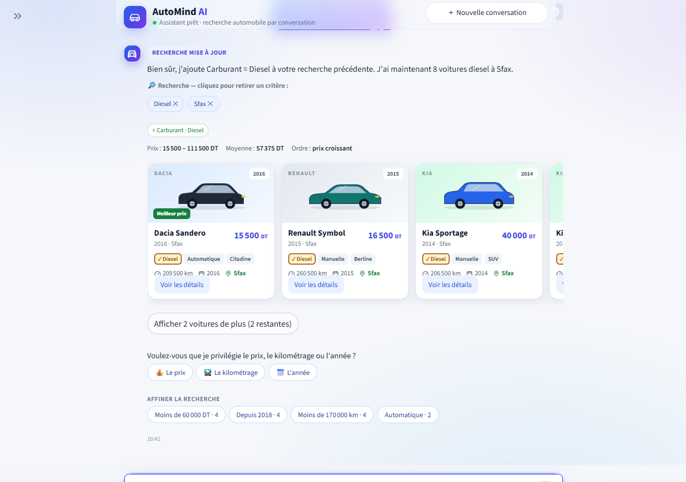
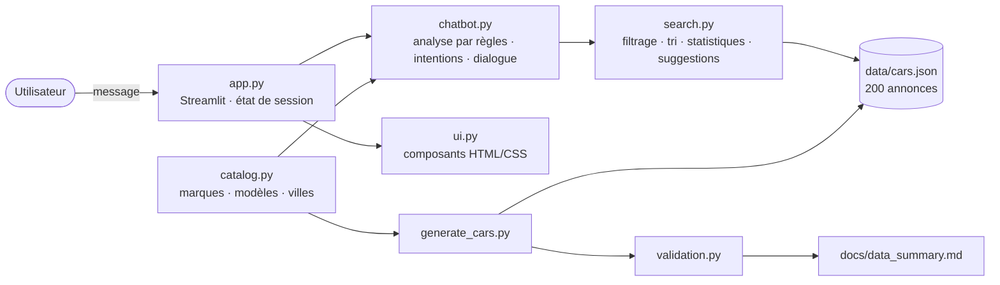
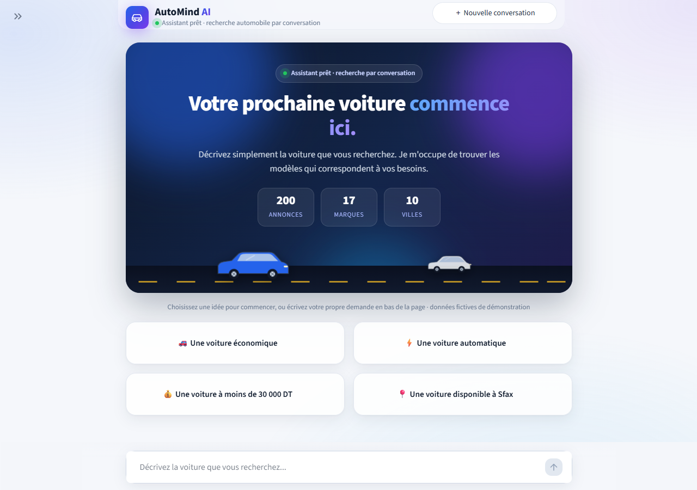
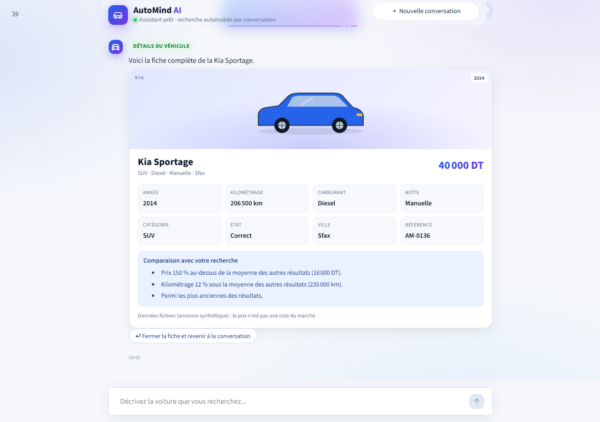
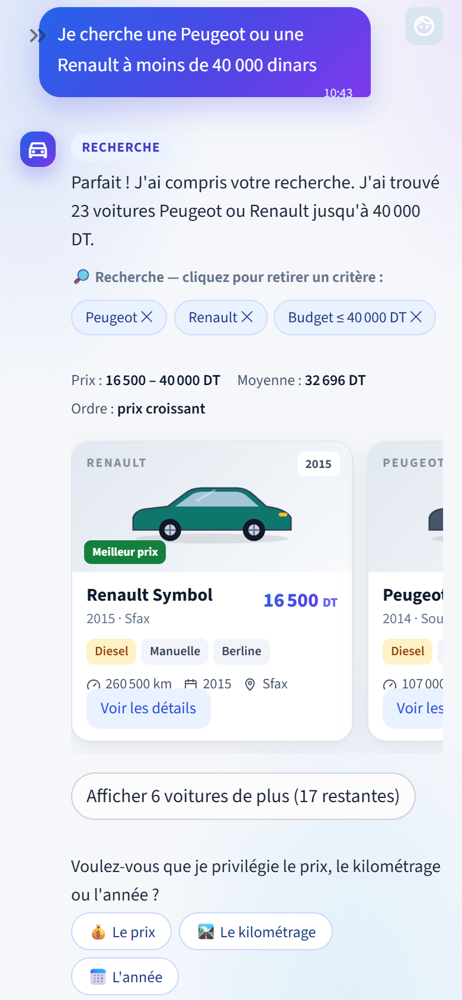

<div align="center">


# Findrive Assistant

**Assistant conversationnel de recherche de voitures d'occasion, en français.**
*Votre prochaine voiture, trouvée simplement.*

[](https://github.com/MohamedTrikii/AutoMind_AI_Assistant/actions/workflows/ci.yml)


[](https://docs.astral.sh/ruff/)
[](LICENSE)



</div>

## Sommaire

- [Présentation](#présentation)
- [Fonctionnalités](#fonctionnalités)
- [Stack technique](#stack-technique)
- [Architecture](#architecture)
- [Démarrage rapide](#démarrage-rapide)
- [Exemples de conversation](#exemples-de-conversation)
- [Ce que comprend l'assistant](#ce-que-comprend-lassistant)
- [Qualité et tests](#qualité-et-tests)
- [Structure du dépôt](#structure-du-dépôt)
- [Gestion de projet](#gestion-de-projet)
- [Captures d'écran](#captures-décran)
- [Licence](#licence)

## Présentation

Findrive Assistant est une application web d'une seule page : l'utilisateur décrit la voiture qu'il cherche en langage naturel, l'assistant extrait les critères (ville, carburant, budget, kilométrage, année, marque…) et **affiche les véhicules correspondants directement dans la conversation**, sous forme de cartes.

> « Je cherche une voiture diesel à Sfax » → « Budget maximum 40 000 dinars » → « Montre-moi des modèles plus récents »

Choix de conception :

- **Compréhension du langage par règles, sans modèle de langage** : expressions régulières et vocabulaire extrait de la base. Pas d'API ni de clé, fonctionne hors ligne, résultats déterministes et testables.
- **Dialogue multi-tours** : les critères sont conservés d'un message à l'autre ; chaque message ajoute, remplace ou retire un critère.
- **Rien n'est deviné** : une demande ambiguë ou impossible (couleur, ville absente, bornes contradictoires…) est signalée à l'utilisateur au lieu d'être interprétée au hasard.
- **Données synthétiques reproductibles** : 200 annonces fictives générées avec une graine fixe et validées automatiquement.

## Fonctionnalités

| | |
|---|---|
| 💬 **Recherche en langage naturel** | Bornes strictes ou inclusives (« moins de » / « maximum »), intervalles, plusieurs valeurs (« Peugeot ou Renault »), synonymes (gasoil, gazole…) |
| 🔁 **Contexte conversationnel** | Ajout, remplacement, retrait (« enlève le critère diesel »), « augmente le budget à 50 000 DT », « nouvelle recherche » |
| 🃏 **Résultats dans le chat** | Carrousel de cartes, badge « Meilleur prix », critères correspondants mis en évidence, « Afficher plus » |
| 🔍 **Fiche détaillée** | Caractéristiques complètes et comparaison avec les autres résultats |
| 🧭 **Suggestions utiles** | Pistes d'affinage et d'élargissement avec le **nombre réel** de résultats, affichées seulement si elles aboutissent |
| 🏷️ **Critères cliquables** | ✕ sur une puce pour retirer un critère sans retaper la demande |
| 📱 **Responsive** | Interface vérifiée en 1280 px et 390 px (mobile) |
| 🛡️ **Robustesse** | Annonces mal formées écartées avec avertissement, JSON corrompu géré, base régénérée en mémoire si le fichier est absent |

## Stack technique

| Domaine | Outils |
|---|---|
| Langage | Python 3.10+ (annotations de type, `dataclasses`) |
| Interface | Streamlit (chat, état de session) + composants HTML/CSS sur mesure |
| Moteur conversationnel | Expressions régulières, normalisation Unicode, vocabulaire dérivé des données |
| Tests | pytest, Streamlit `AppTest`, Playwright (navigateur réel), pytest-cov |
| Qualité | Ruff (lint, tri des imports), GitHub Actions (CI sur Python 3.10 → 3.13) |
| Déploiement | Docker, compatible Streamlit Community Cloud |

## Architecture



Le moteur expose `process_message(message, criteres_precedents, voitures)`, qui renvoie l'intention détectée, les critères mis à jour, les avertissements et la réponse. Il est **indépendant de Streamlit** : on peut le tester, ou le brancher sur une autre interface, sans rien changer.

## Démarrage rapide

### Avec Python

```bash
git clone https://github.com/MohamedTrikii/AutoMind_AI_Assistant.git
cd AutoMind_AI_Assistant
python -m venv .venv && source .venv/bin/activate   # Windows : .venv\Scripts\activate
pip install -r requirements.txt
streamlit run app.py                                # http://localhost:8501
```

Sous Windows, un double-clic sur [`scripts/lancer.bat`](scripts/lancer.bat) vérifie Python, installe les dépendances et lance l'application ([`scripts/lancer.sh`](scripts/lancer.sh) sous macOS / Linux). Ajoutez l'argument `tests` pour lancer la suite de tests.

### Avec Docker

```bash
docker build -t automind-ai .
docker run --rm -p 8501:8501 automind-ai
```

### Régénérer le jeu de données

```bash
python -m automind.generate_cars                                   # 200 annonces, graine 42
python -m automind.generate_cars --count 300 --seed 7 --output cars_300.json --summary ""
```

| Option | Défaut | Rôle |
|---|---|---|
| `--count` | 200 | Nombre d'annonces (≥ 12, les fixtures de test sont incluses) |
| `--seed` | 42 | Graine aléatoire : même graine = même fichier |
| `--output` | `data/cars.json` | Fichier de sortie |
| `--summary` | `docs/data_summary.md` | Résumé Markdown (`""` pour ne pas l'écrire) |

Le script valide la base et s'arrête avec un code d'erreur si un contrôle échoue. Si `data/cars.json` est absent, l'application génère la base par défaut en mémoire.

## Exemples de conversation

Résultats réels sur `data/cars.json` (graine 42) :

| Message | Critères reconnus | Résultats |
|---|---|---:|
| `voiture à Tunis` | Ville = Tunis | 46 |
| `diesel moins de 40000 DT` | Carburant = Diesel, Prix < 40 000 DT | 24 |
| `Peugeot à Sfax` | Marque = Peugeot, Ville = Sfax | 3 |
| `essence à Tunis moins de 45000 DT` | Ville, Carburant, Prix max | 18 |
| `diesel à Tunis moins de 40000 DT et moins de 100000 km` | 4 critères | 3 |
| `Toyota après 2020` | Marque = Toyota, Année ≥ 2021 | 5 |

Scénario multi-tours :

1. `Je cherche une voiture diesel à Sfax.` → 8 voitures, en cartes dans la réponse
2. `Budget maximum 40 000 dinars.` → « D'accord, je limite la recherche à 40 000 DT. » → 3
3. `Montre-moi des modèles plus récents.` → même recherche, classée par année
4. `Voir les détails` sur une carte → fiche complète, comparée aux autres résultats
5. `Enlève le critère diesel.` → 6
6. `Augmente le budget à 50 000 DT.` → « je passe le budget de 40 000 DT à 50 000 DT » → 10
7. `Nouvelle recherche` → critères effacés

## Ce que comprend l'assistant

| Critère | Exemples |
|---|---|
| Ville | à Tunis, sur Tunis, de Sfax (10 villes de la base) |
| Carburant | diesel / gasoil / gazole, essence, électrique, hybride |
| Marque, modèle | Peugeot, VW, Citroën… · 208, Clio, Golf, i20, Série 3 (liste issue des données) |
| Prix maximum | moins de 40 000 DT, inférieure à 40 000, budget max 40k, jusqu'à 40 000 dinars, pas plus de 40 000 DT |
| Prix minimum | plus de 30 000 DT, au moins 30 000 DT, à partir de 30 000 DT · intervalle : entre 30 000 et 40 000 DT |
| Kilométrage | moins de 100 000 km, maximum 100000 km, moins de 100k km · plus de 50 000 km, entre 50 000 et 80 000 km |
| Année | de 2020, modèle 2019, après 2018 (≥ 2019), depuis 2020, avant 2022, entre 2018 et 2021 |
| Catégorie, boîte | SUV, berline, citadine, compacte · automatique, manuelle |
| Plusieurs valeurs | une Peugeot ou une Renault · diesel ou hybride · à Tunis ou Sousse |
| Suivi | à Tunis seulement, plutôt à Sfax, augmente le budget à 50 000 DT, peu importe la ville |
| Retrait | enlève le critère diesel, enlève Renault, sans limite de prix |
| Ordre | plus récentes, moins chère, économique, moins kilométrées, privilégie le prix / le kilométrage / l'année |
| Réinitialisation | nouvelle recherche, réinitialiser, oublie les critères précédents, recommencer |

- **Contexte** : les critères sont conservés d'un message à l'autre. Seule une demande explicite (« nouvelle recherche ») repart de zéro.
- **Bornes** : « moins de », « inférieur à », « sous », « plus de », « supérieur à » sont **strictes** (« moins de 40 000 DT » exclut 40 000 DT) ; « maximum », « jusqu'à », « au plus », « pas plus de », « budget », « au moins », « à partir de », « entre … et … » sont **inclusives**.
- **Préférences vagues** (« pas chère », « récente ») : elles changent l'ordre des résultats sans inventer de budget ni d'année.
- **Ce qui n'est pas compris est signalé, jamais deviné** : couleur, ville ou marque absente, modèle inexistant, carburant absent de la base (GPL…), montant négatif ou trop faible, bornes contradictoires, « augmente le budget » sans montant.

## Qualité et tests

```bash
pip install -r requirements-dev.txt
pytest --cov                                    # suite principale : 188 tests (moteur, données, AppTest)
pytest qa/test_code --ignore=qa/test_code/ui    # campagne QA : unitaires, intégration, cas limites, régression
pytest qa/test_code/ui                          # tests navigateur (Playwright + Chrome ou Edge installé)
ruff check .                                    # lint
```

| Suite | Contenu |
|---|---|
| [`tests/`](tests/) | Analyse des messages, dialogue multi-tours, filtrage, validation du jeu de données, application Streamlit pilotée par `AppTest`, risques connus documentés en `xfail` |
| [`qa/test_code/`](qa/test_code/) | Campagne QA de 70 cas (unitaires, fonctionnels, intégration, cas limites, régression, UI). Les résultats attendus sont calculés par un **oracle indépendant** du code testé ; les résultats obtenus sont enregistrés dans [`qa/results/`](qa/results/), avec captures avant / après correction |

- Couverture du moteur (`automind/`, hors CSS) : **88 %**.
- L'intégration continue lance le lint, la suite principale sur Python 3.10, 3.12 et 3.13, puis la campagne QA, et vérifie que `data/cars.json` est bien reproductible à partir de la graine 42.
- Plan de test, résultats et rapport : [`docs/testing/`](docs/testing/).

## Structure du dépôt

```
AutoMind_AI_Assistant/
├── app.py                  # Point d'entrée Streamlit : la page de conversation
├── automind/               # Package applicatif
│   ├── chatbot.py          #   analyse par règles, intentions, dialogue multi-tours
│   ├── search.py           #   chargement, filtrage, tri, statistiques, suggestions
│   ├── catalog.py          #   référentiel : marques, modèles, villes, carburants
│   ├── ui.py               #   CSS et composants HTML (cartes, bulles, fiche détaillée)
│   ├── generate_cars.py    #   génération reproductible du jeu de données (CLI)
│   └── validation.py       #   contrôles de cohérence et résumé Markdown
├── data/                   # cars.json (200 annonces fictives) · test_fixtures.json
├── tests/                  # Suite de tests principale (pytest)
├── qa/                     # Campagne QA : code de test, résultats, captures avant / après
├── docs/                   # Gestion de projet, rapports de test, notes UI, captures
├── scripts/                # Lanceurs Windows / macOS / Linux
├── .github/workflows/      # Intégration continue
├── .streamlit/config.toml  # Thème
├── Dockerfile
└── pyproject.toml          # Métadonnées, configuration pytest / coverage / ruff
```

## Gestion de projet

Le projet a été mené avec un dossier de pilotage complet :

| Document | Contenu |
|---|---|
| [Rapport de projet](docs/management/project_report.md) | Périmètre, WBS, équipe, risques, arbitrages |
| [Planning](docs/management/planning.csv) · [Gantt](docs/management/gantt.md) | Planification et suivi |
| [Backlog](docs/management/backlog.csv) | User stories et priorités |
| [Plan de test](docs/testing/test_plan.csv) · [Résultats](docs/testing/test_results.csv) · [Rapport de tests](docs/testing/rapport_tests.md) | Stratégie et exécution des tests |
| [Résumé des données](docs/data_summary.md) | Statistiques du jeu de données généré |
| [Notes de design UI](docs/ui_design_notes.md) | Choix d'interface et accessibilité |

## Captures d'écran

| Accueil | Fiche détaillée | Mobile |
|---|---|---|
|  |  |  |

D'autres captures sont dans [`docs/screenshots/`](docs/screenshots/).

> **Données** : les 200 annonces sont **synthétiques et fictives** ; les prix ne sont pas des cotes du marché.

## Licence

Distribué sous licence MIT. Voir [LICENSE](LICENSE).

**Auteur** : Mohamed Trikii · [GitHub](https://github.com/MohamedTrikii)
