# Diagramme de Gantt — AutoMind AI (120 minutes)

Session unique de **120 minutes**, 4 membres. Les heures sont relatives (00:00 = début de séance).
Source : [planning.csv](planning.csv).

**Contrainte respectée : les tests passent avant le filtrage.** Le plan de test (Q01, fin à 30 min) et les tests automatisés des 5 scénarios (Q02, fin à 45 min) sont terminés **avant** le début du développement du filtrage (D04, début à 46 min).

```mermaid
gantt
    title AutoMind AI — séance de 120 minutes
    dateFormat HH:mm
    axisFormat %H:%M

    section Pilotage (M1)
    P01 Cadrage (tous)                 :p01, 00:00, 00:10
    P02 WBS, backlog, affectations     :p02, 00:10, 00:22
    P03 Planning et Gantt              :p03, 00:22, 00:30
    P04 Point d'étape                  :p04, 00:30, 00:40
    P05 README                         :p05, 00:40, 00:55
    P06 Rapport de projet              :p06, 00:55, 01:25
    P07 Mise à jour docs finale        :p07, 01:25, 01:50
    P08 Captures et livrables          :p08, 01:50, 01:55

    section Données et moteur (M2)
    D01 Catalogue                      :d01, 00:10, 00:20
    D02 Générateur reproductible       :d02, 00:20, 00:38
    D03 Validation et résumé           :d03, 00:38, 00:46
    D04 Filtrage et tri                :crit, d04, 00:46, 00:56
    D05 Analyseur par règles           :d05, 00:56, 01:18
    D06 Multi-tours et intentions      :d06, 01:18, 01:38
    D07 Intégration (avec M3)          :d07, 01:38, 01:50
    D08 Régénération finale            :d08, 01:50, 01:55

    section Interface (M3)
    U01 Maquette et notes UI           :u01, 00:10, 00:25
    U02 En-tête, héros, indicateurs    :u02, 00:25, 00:45
    U03 Cartes, critères, état vide    :u03, 00:45, 01:05
    U04 Chat et état de session        :u04, 01:05, 01:22
    U05 Barre latérale et filtres      :u05, 01:22, 01:38
    D07 Intégration (avec M2)          :u07, 01:38, 01:50
    U06 Finitions et mobile            :u06, 01:50, 01:55

    section Qualité (M4)
    Q01 Plan de test et fixtures       :crit, q01, 00:10, 00:30
    Q02 Tests des 5 scénarios          :crit, q02, 00:30, 00:45
    Q03 Tests du jeu de données        :q03, 00:45, 00:58
    Q04 Tests NLU et multi-tours       :q04, 00:58, 01:20
    Q06 Prompts de démonstration       :q06, 01:20, 01:38
    Q05 Exécution et résultats         :q05, 01:38, 01:50
    Q07 Non-régression                 :q07, 01:50, 01:55

    section Clôture (tous)
    P09 Répétition de la démo          :p09, 01:55, 02:00
```

## Vue texte (créneaux en minutes)

| Membre | 0–10 | 10–30 | 30–46 | 46–58 | 58–80 | 80–98 | 98–110 | 110–115 | 115–120 |
|---|---|---|---|---|---|---|---|---|---|
| M1 | P01 | P02 (→22), P03 (→30) | P04 (→40), P05 (→55) | P05, P06 (55→) | P06 (→85) | P07 (85→) | P07 (→110) | P08 | P09 |
| M2 | P01 | D01 (→20), D02 (→38) | D02, D03 (38→46) | **D04 filtrage (46→56)**, D05 | D05 (→78), D06 | D06 (→98) | D07 | D08 | P09 |
| M3 | P01 | U01 (→25), U02 | U02 (→45), U03 | U03 (→65) | U03, U04 (65→82) | U05 (82→98) | D07 | U06 | P09 |
| M4 | P01 | **Q01 (→30)** | **Q02 (30→45)**, Q03 | Q03 (→58) | Q04 (58→80) | Q06 (80→98) | Q05 | Q07 | P09 |

Q02 se termine à la minute 45 et D04 (filtrage) démarre à la minute 46.

## Charge par membre

| Membre | Rôle | Minutes planifiées | Dont travail ajouté par les exigences enrichies |
|---|---|---:|---:|
| M1 | Chef de projet / documentation | 120 | 42 (WBS étendue P02, mise à jour finale P07, captures P08) |
| M2 | Données et moteur conversationnel | 120 | 83 (D01, D02, D03, D05, D06, D08) |
| M3 | Interface Streamlit | 120 | 93 (U01 à U06) |
| M4 | Qualité et tests | 120 | 73 (Q01, Q03, Q04, Q06) |

Marge : **0 minute**. Le chemin critique est D05 → D06 → D07 → P09. Voir l'analyse des arbitrages dans [project_report.md](project_report.md#6-arbitrages-de-temps).
